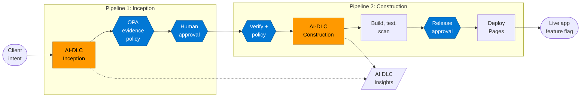

# AI-DLC Demo App

A tiny, dependency-free demo app that re-skins itself by **industry** and **company**, Harness-themed by default. Built for the AI-DLC project.

## How AI-DLC runs in Harness

The AI-DLC methodology is [AWS Labs' `aidlc-workflows`](https://github.com/awslabs/aidlc-workflows). Claude Code runs it unattended inside Harness CI. Harness adds the enforced approval gates, policy checks, build, test, scan, deploy and measurement around it.



**Legend:** orange steps are AWS AI-DLC, run by Claude Code. Blue steps are Harness governance gates. Everything else is standard CI/CD.

| AI-DLC phase | Covered here | Notes |
|--------------|--------------|-------|
| Inception | Yes | Pipeline 1, stops at the first gate |
| Construction | Yes | Pipeline 2, runs only after approval |
| Operations | No | Not in these pipelines |

## Use your own AI coding tool (Kiro, Cursor, Claude Code)

AI-DLC is one core that runs natively in several tools. The Harness pipelines use Claude Code in CI; at your
desk you can use whichever you prefer. Install AI-DLC, then configure the project:

```bash
curl -fsSL https://github.com/awslabs/aidlc-workflows/releases/latest/download/install.sh | sh
aidlc config --harness kiro      # or: cursor, claude
aidlc doctor
```

Open the project in your tool and run `/aidlc <what you want to build>` (in Kiro IDE, choose **aidlc** in the agent picker first).
Full copy-paste steps, the Kiro CLI variants, and a hybrid flow that hands the result to Harness for gates and delivery
are in [DEMO.md](DEMO.md#demo-track-b-run-ai-dlc-interactively-in-kiro-or-cursor).

## Run

```bash
python3 -m http.server 8000
# open http://localhost:8000
```

## Customize

| What | How |
|------|-----|
| Industry | Use the picker in the header, set `industry` in `config.json`, or add `?industry=insurance` to the URL |
| Company branding from a website | `python3 scripts/brand.py https://www.example.com --industry insurance` |
| Colors / name by hand | Edit `config.json` (or `?company=Acme&primary=%23ff6600` for a quick demo) |
| Add or edit industries | Edit `industries.json` (labels, statuses, KPIs, sample records) |

Industry keys: `retail`, `healthcare`, `financial-services`, `insurance`, `manufacturing`, `travel`, `technology`.

The website fetch is best effort: it reads the page title, Open Graph tags, icon link and `theme-color`. Check `config.json` afterwards and fix anything it got wrong.

## Rebrand for a customer (standard Harness to their brand)

Run one command from the project root. It reads the company's website for the name and logo, and the flags set the
parts a website rarely exposes (a short name and brand colors). Example for a fictional company:

```bash
python3 scripts/brand.py https://www.acme-pharma.example --industry healthcare \
  --name "Acme Pharma" --primary '#E60028' --accent '#FF5A73' --dark '#1A1A1F'
python3 -m http.server 8000
```

Refresh http://localhost:8000 and you should see the company's name and logo in the header, the brand color on the
banner, and the industry's own tagline and records (healthcare shows "Cases").

| Flag | What it sets |
|------|--------------|
| `--industry` | Which preset to use (`retail`, `healthcare`, `financial-services`, `insurance`, `manufacturing`, `travel`, `technology`) |
| `--name` | Short company name (site titles are often long, like "Acme: Global Homepage") |
| `--primary`, `--accent`, `--dark` | Brand colors as `#RRGGBB`. Find them in the company's brand guidelines or with a color picker on their site |

The site fetch is best effort, so check the result. If the logo looks wrong, edit `company.logoUrl` in `config.json`.
Customer-specific branding is a local change: undo it with the reset below before you commit.

## Reset to Harness

```bash
git checkout config.json
```

Or set `config.json` back to the defaults by hand (`company.name` "Harness", `https://www.harness.io`, primary `#0278D5`).
